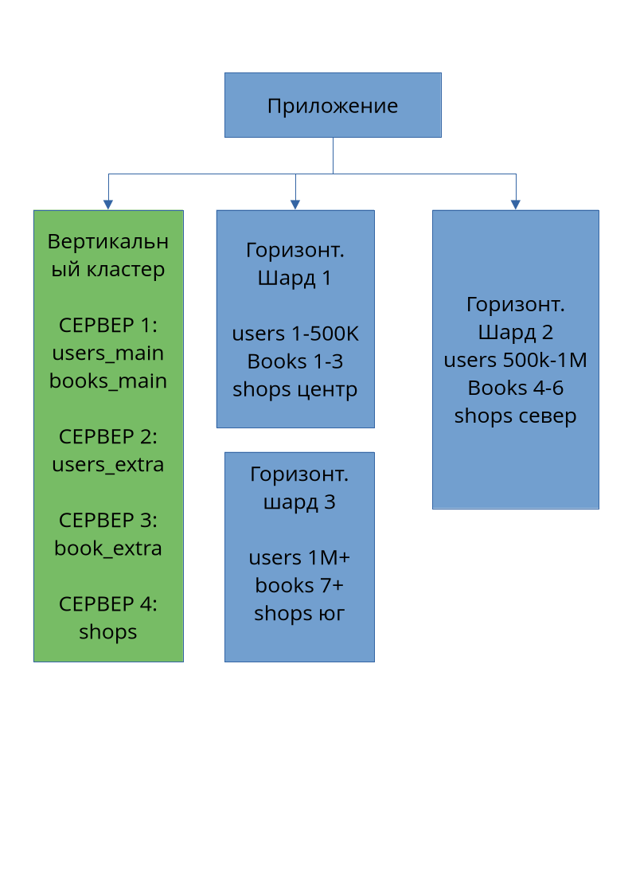

# Домашнее задание к занятию «Репликация и масштабирование. Часть 2» - `Леонов Алексей`

---

### Задание 1.

Задание 1
Опишите основные преимущества использования масштабирования методами:
- активный master-сервер и пассивный репликационный slave-сервер;
- master-сервер и несколько slave-серверов;
Дайте ответ в свободной форме.

### Решение 1

- Один master и один пассивный slave

Тут slave просто стоит наготове и копирует себе все данные с мастера. Клиенты к нему не ходят — он нужен на случай аварии.
Что это даёт:

1. Если мастер упадёт — есть замена. Slave уже содержит копию всех данных, поэтому на него можно быстро переключиться. Система не встанет.
2. Можно спокойно обслуживать мастер. Обновить, перезагрузить, поменять железо — переключил нагрузку на slave и делай что хочешь. Пользователи ничего не заметят.
3. Бэкапы можно снимать со slave. Мастер не нагружается лишний раз. Но важно помнить: реплика — это не замена бэкапу. Если на мастере случайно удалить данные, они удалятся и на slave тоже.
4. Просто. Записи идут только на master, slave только читает. Никаких конфликтов, никакой сложной логики.
Минус: slave не помогает с нагрузкой — он же не обслуживает запросы. И данные до него доходят с небольшой задержкой.

- Один master и несколько slave

Здесь slave уже работают — на них уходят все запросы на чтение (SELECT). Записи по-прежнему идут только на master.

Что это даёт:
1. Чтение распределяется между репликами. В обычных приложениях читают намного чаще, чем пишут. Несколько slave — это в разы больше мощности на чтение.
2. Производительность растёт без переписывания кода. Добавил ещё один slave — и часть запросов ушла на него. Приложение как работало, так и работает.
3. Отказоустойчивость выше. Один slave упал — остальные продолжают работать. Мастер упал — любого slave можно сделать новым мастером.
4. Master не тратит силы на чтение. Он занимается только записью. Slave — только чтением. Каждый сервер заточен под свою задачу.
5. Можно ставить slave в разных регионах. Пользователи читают данные с ближайшего сервера — быстрее и удобнее.
6. На slave можно гонять тяжёлые отчёты и тесты. Они не мешают мастеру работать.
Минус: записи всё равно упираются в один master — его мощность остаётся потолком. И данные между серверами могут на пару секунд расходиться.

### Задание 2.

Разработайте план для выполнения горизонтального и вертикального шаринга базы данных. База данных состоит из трёх таблиц:
- пользователи,
- книги,
- магазины (столбцы произвольно).
Опишите принципы построения системы и их разграничение или разбивку между базами данных.
Пришлите блоксхему, где и что будет располагаться. Опишите, в каких режимах будут работать сервера.

### Решение 2
- План шардинга

Исходные таблицы

users  (user_id, login, password, email, bio)
books  (book_id, title, author, category_id, description)
shops  (shop_id, name, city, book_id)

1. Вертикальный шардинг — делим по столбцам

Тяжёлые и редкие столбцы убираем на отдельный сервер, чтобы не мешали частым запросам.

users → users_main (user_id, login, email) + users_extra (user_id, password, bio)
books → books_main (book_id, title, author, category_id) + books_extra (book_id, description)
shops не трогаем — таблица маленькая

Сервер 1	users_main, books_main
Сервер 2	users_extra
Сервер 3	books_extra
Сервер 4	shops
Если приложению нужен полный профиль пользователя — оно делает два запроса (на Сервер 1 и Сервер 2) и склеивает ответ.

2. Горизонтальный шардинг — делим по строкам
Идея: одинаковые таблицы, но строки раскиданы по разным серверам по ключу.

users — делим по user_id:

Шард 1: id 1–500 000
Шард 2: id 500 001–1 000 000
books — делим по category_id:
Шард 1: категории 1–3
Шард 2: категории 4–6
Шард 3: категории 7+
shops — делим по city:
Шард 1: центр
Шард 2: север
Шард 3: юг
Каждый шард — отдельный сервер.

3. Блок-схема
**Скриншот 1: Блок-схема:**

4. Режимы работы серверов
Master — принимает записи (INSERT, UPDATE, DELETE).
Slave — обслуживает чтение (SELECT) и подстраховывает мастера.
В каждом шарде — свой master, рядом может быть slave.

Репликация:
для users — синхронная (данные важные);
для books и shops — асинхронная (небольшая задержка допустима).

5. Принцип разграничения
Вертикальный шардинг — режем таблицу по столбцам: частое — на один сервер, тяжёлое и редкое — на другой.
Горизонтальный шардинг — режем таблицу по строкам: разные диапазоны значений (id, категория, город) уезжают на разные серверы.
Приложение само знает, куда обратиться за нужной частью данных, и склеивает результат.

